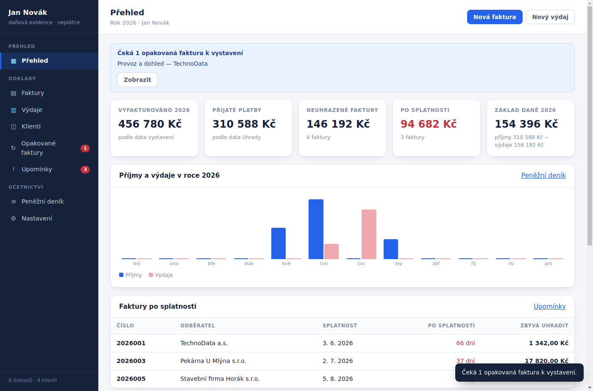
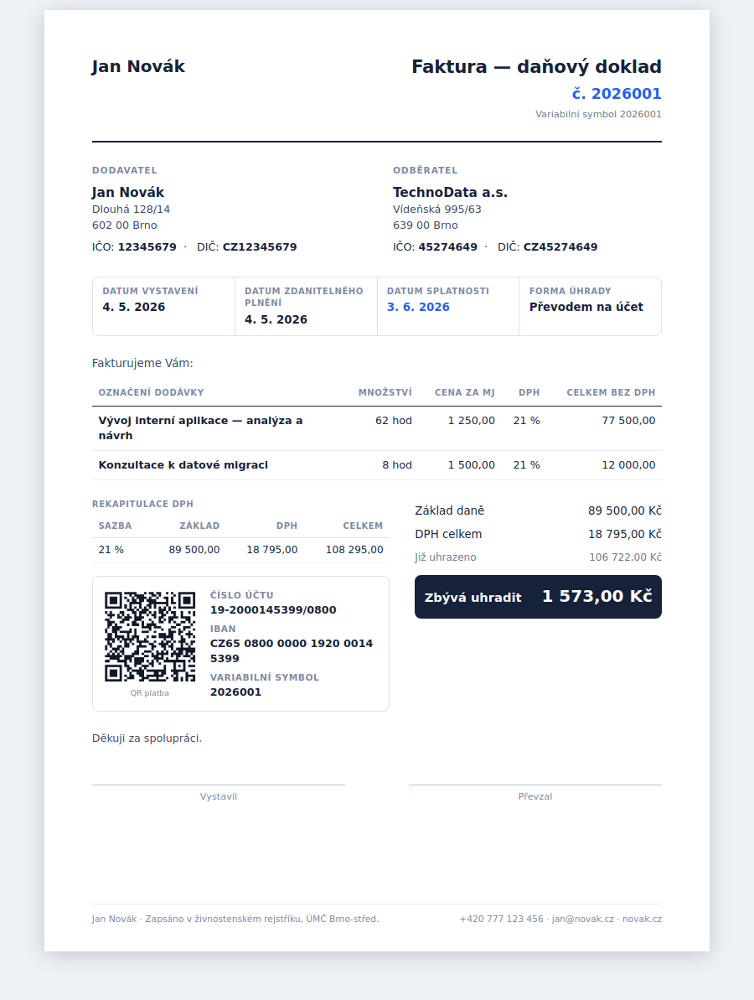

# Fakturace

Desktopová aplikace pro fakturaci a vedení daňové evidence OSVČ.
Ve výchozím stavu počítá s **plátcem DPH**; kdo plátcem není, přepínač
v nastavení daň naopak vypne. Běží ve Windows, Linuxu i na macOS, data
zůstávají v počítači.



## Co aplikace umí

**Faktury**
- Faktury, zálohové faktury a dobropisy
- Sazby DPH 21 %, 12 % a 0 %, ceny lze zadávat s daní i bez daně
- U neplátce (přepínač v nastavení) doklad daň neuvádí a nese poznámku
  „Nejsem plátcem DPH“
- Přenesená daňová povinnost, dodání do EU, vývoz, osvobozená plnění
- Slevy na řádek i na celý doklad, zaokrouhlení na celé koruny
- Odpočet zaplacených záloh na konečné faktuře
- Tisk a export do PDF včetně **QR platby** podle českého standardu
- Částečné úhrady, stavy dokladů, storno



**Daňová evidence**
- Peněžní deník podle skutečných plateb (příjmy až v okamžiku úhrady)
- Evidence přijatých faktur, paragonů a interních dokladů
- Rozlišení daňových a nedaňových výdajů (osobní spotřeba, odvody)
- Krácený odpočet DPH u výdajů používaných i soukromě (jen u plátce)
- Průběžný základ daně z příjmů, přehled podle kategorií

**DPH** (schová se, pokud v nastavení vypnete plátcovství)
- Podklady pro přiznání k DPH s čísly řádků tiskopisu
- Kontrolní hlášení rozdělené do oddílů A.1, A.4, A.5, B.1, B.2, B.3
- Měsíční i čtvrtletní zdaňovací období
- Export dokladů i kontrolního hlášení do CSV pro účetní

**Ostatní**
- Adresář klientů s načtením firmy z registru ARES podle IČO
- Opakované faktury podle šablon (měsíčně až ročně)
- Upomínky po splatnosti s upravitelnou šablonou textu
- Automatická denní záloha dat, export a obnovení celé databáze

## Spuštění

Potřebujete [Node.js](https://nodejs.org/) 18 nebo novější.

```bash
cd fakturace
npm install
npm start
```

## Instalace na Windows

Hotový instalátor sestavuje GitHub Actions při každé změně ve složce
`fakturace/`. Stáhnete ho takhle:

1. V repozitáři otevřete záložku **Actions**
2. Vyberte poslední běh **„Fakturace — instalátor pro Windows“**
3. Dole v části **Artifacts** stáhněte **Fakturace-Windows**
4. V rozbaleném archivu jsou dva soubory:
   - `Fakturace-1.0.0-x64.exe` — instalátor (nabídne složku, vytvoří zástupce)
   - `Fakturace-1.0.0-x64-portable.exe` — spustí se bez instalace

Windows u nepodepsaného programu ukáže modré okno SmartScreenu. Klikněte
na **Další informace → Přesto spustit**. Podpis by vyžadoval placený
certifikát vydavatele.

### Sestavení instalátoru vlastními silami

```bash
npm run dist            # instalátor .exe a přenosná verze
npm run dist:portable   # jen přenosná verze bez instalace
```

Hotové soubory najdete ve složce `dist/`. Musí se to spustit **na Windows** —
na Linuxu ani macOS instalátor NSIS vytvořit nejde, tam vznikne jen balíček
pro daný systém.

## Mobilní verze (iOS, Android)

Ve složce `mobile/` je verze aplikace pro telefon — stejné jádro (výpočty
DPH, faktury, deník) jako desktopová appka, jen jinak zabalené: místo
souboru na disku se data ukládají do úložiště prohlížeče (`localStorage`)
a tisk/PDF jde přes tiskový dialog prohlížeče místo přes Electron.

**Vlastní hosting** — nasaďte celou složku `fakturace/` (potřebuje `mobile/`
i `src/renderer/`) na libovolný statický web (GitHub Pages, Netlify, vlastní
doména…) a otevřete `mobile/index.html`. Přidá se přes „Přidat na plochu“
na iOS i Androidu, funguje pak i offline (service worker v `mobile/sw.js`).

**Jeden HTML soubor** — `node mobile/build-artifact.js vystup.html` slepí
appku i se vším JS/CSS do jednoho samostatného souboru bez závislostí na
zbytku repozitáře. Hodí se všude tam, kde jde nahrát jen jeden soubor.
Spouští se znovu pokaždé, když se změní zdrojové soubory appky.

DPH a ARES fungují stejně jako na desktopu; načtení firmy z ARESu ale
záleží na tom, jestli prohlížeč/hosting dovolí volání na `ares.gov.cz`
(u jednosouborové verze to typicky nejde — appka to sama pozná a nabídne
ruční vyplnění).

## Kde jsou data

Všechno je v jednom souboru `data.json`:

| Systém  | Umístění                                       |
| ------- | ---------------------------------------------- |
| Windows | `%APPDATA%\Fakturace\data.json`                |
| Linux   | `~/.config/Fakturace/data.json`                |
| macOS   | `~/Library/Application Support/Fakturace/`     |

Zálohy se ukládají do podsložky `zalohy/` — automaticky při prvním spuštění
v daný den a kdykoli ručně z nastavení. Zápis je atomický, takže výpadek
proudu uprostřed ukládání data nepoškodí.

Aplikace se připojuje k internetu jedině tehdy, když sami kliknete na
načtení firmy z ARESu. Nic se nikam neodesílá.

## Na co si dát pozor

Aplikace vede evidenci a připraví podklady — **přiznání za vás nepodá**.
Konkrétně:

- Negeneruje XML pro portál MOJE daně. Čísla jsou připravená k přepsání
  do formuláře a doklady jdou vyexportovat do CSV pro účetní.
- Zálohová faktura není daňový doklad. Aplikace ji umí vystavit a odečíst
  na konečné faktuře, ale daňový doklad k přijaté platbě nevytváří.
- Jde o **daňovou evidenci**, ne podvojné účetnictví. Pro s.r.o. s účtovým
  rozvrhem a rozvahou se nehodí.
- Aplikace nehlídá obrat pro povinnou registraci k DPH ani rozhodnou částku,
  od které se u vedlejší činnosti platí pojistné. Na obojí si musíte dohlédnout
  sami — v peněžním deníku k tomu najdete průběžné součty.
- Sazby DPH ani limity kontrolního hlášení nejsou napojené na žádný číselník
  — při změně zákona je potřeba upravit `src/renderer/js/core/model.js`.

## Struktura projektu

```
src/main/          hlavní proces Electronu
  main.js            okno a nabídka aplikace
  ipc.js             obsluha volání z okna
  store.js           čtení a atomický zápis dat, zálohy
  pdf.js             tisk dokladu do PDF
  ares.js            načtení firmy z registru ARES
  preload.js         seznam funkcí dostupných oknu

src/renderer/      okno aplikace
  js/core/           výpočty bez vazby na rozhraní (testovatelné v Node)
    util.js            čísla, datumy, zaokrouhlení
    validace.js        IČO, DIČ, číslo účtu, IBAN
    vypocet.js         výpočet dokladu, stavy, úhrady
    dph.js             přiznání k DPH, kontrolní hlášení
    denik.js           peněžní deník, pohledávky a závazky
    platba.js          řetězec QR platby (formát SPD)
    model.js           datový model, číselné řady, výchozí nastavení
    csv.js             export pro Excel
  js/pohledy/        jednotlivé obrazovky
  js/doklad.js       tisková podoba faktury
  js/app.js          směrování a spuštění

test/              testy
```

## Testy

```bash
npm test        # výpočty DPH, zaokrouhlení, IBAN, deník, číselné řady
npm run snimek  # projde všechny obrazovky a uloží z nich snímky
```

Test `npm run snimek` spustí aplikaci nad dočasnými ukázkovými daty,
projde všechny obrazovky ve **dvou variantách — jako neplátce i jako plátce
DPH** — uloží z nich snímky a PDF faktury a skončí chybou, pokud se některá
obrazovka nevykreslí nebo se doklad zachová jinak, než má (třeba když by
faktura neplátce vyčíslovala daň). Na Linuxu bez obrazovky ho spusťte
přes `xvfb-run`.
